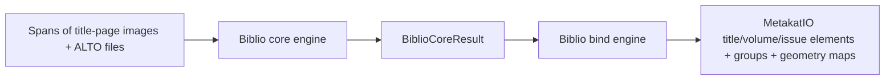
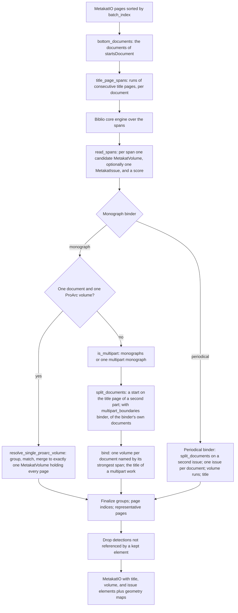

# Bibliographic processing

## Navigation

- [Purpose](#purpose)
- [Biblio core engine contract](#biblio-core-engine-contract)
  - [Result model](#result-model)
  - [Grouping](#grouping)
  - [Implementing another core engine](#implementing-another-core-engine)
- [Core and bind orchestration](#core-and-bind-orchestration)
  - [Pipeline configuration](#pipeline-configuration)
  - [Processing handoff](#processing-handoff)
- [Available core implementation](#available-core-implementation)
  - [YOLO + ALTO](#engine-yolo--alto-biblio_core_engine_yolo_monograph-biblio_core_engine_yolo_periodical)
    - [Label configuration](#label-configuration)
    - [Reading a page](#reading-a-page)
  - [Vision-language model](#engine-vision-language-model-biblio_core_engine_vlm_monograph-biblio_core_engine_vlm_periodical)
    - [Local models](#local-models)
    - [Another output schema](#another-output-schema)
- [Available bind implementation](#available-bind-implementation)
  - [Binding flow](#binding-flow)
  - [What a scan holds](#what-a-scan-holds)
  - [Documents](#documents)
  - [Title-page spans and core invocation](#title-page-spans-and-core-invocation)
  - [Candidate element construction](#candidate-element-construction)
  - [Proarc single-volume resolution](#proarc-single-volume-resolution)
  - [Periodical volume consolidation](#periodical-volume-consolidation)
  - [Title creation](#title-creation)
  - [Anchor pages](#anchor-pages)
  - [Groups](#groups)
  - [Multipart or monographs](#multipart-or-monographs)
  - [Parts and issues inside one document](#parts-and-issues-inside-one-document)
  - [Hierarchy binding](#hierarchy-binding)
  - [Detection geometry retention](#detection-geometry-retention)
- [Known limitations](#known-limitations)
- [Observability and revision](#observability-and-revision)

## Purpose

The `metakat.biblio` package reads bibliographic evidence from a document's
title pages and builds the container part of the MetaKat document hierarchy:
`MetakatTitle`, `MetakatVolume`, and `MetakatIssue` elements, each carrying
bibliographic fields and groups, plus the `parent_id` relations that attach
every page to a container.

Where one bottom-level document ends and the next begins is the
[page-type stage](../page_type/README.md)'s decision, carried by
`MetakatPage.startsDocument`. This package makes each of those documents one
leaf unit - an issue, a part of a multipart monograph or a monograph - decides
what kind of scan it is and how the leaves bind into periodical volumes and a
title. The one boundary it adds is where a document clearly holds two parts or
two issues, each with its own title page ([splits](#parts-and-issues-inside-one-document)).

Bibliographic processing has two boundaries:

1. The **[core engine](#biblio-core-engine-contract)** reads what is printed
   on spans of title pages. It returns, per span, the bibliographic values it
   could read there as one record - one reading per field where the field
   holds one - already grouped into MODS statements: a title, an imprint, a
   series, a name.
2. The **[bind engine](#available-bind-implementation)** decides what those
   readings describe: it cuts the title pages of every document into spans,
   decides the kind of the scan, splits a document holding two parts or
   issues, lets the strongest span of each document name its leaf, binds the
   leaves into periodical volumes and a title, reconciles a lone volume with
   an optional ProArc catalog record, and creates the detection UUIDs.

The core owns detection, OCR alignment, label interpretation, the choice
between several detections of one field on a page, and grouping. The binder
owns the hierarchy and does not repeat or alter those decisions - the same
split as in the [`page_number`](../page_number/README.md) and
[`chapter`](../chapter/README.md) packages.



## Biblio core engine contract

Every biblio core engine subclasses `BiblioCoreEngine` and exposes:

```python
process(spans: Sequence[Sequence[BiblioPage]]) -> BiblioCoreResult


@dataclass(frozen=True)
class BiblioPage:
    image: str                 # the page image; its filename stem is the page key
    alto: str | None = None    # its ALTO, when it has one
```

A **span** is a run of consecutive title pages of one bottom-level document,
in page order - a half-title and a title page, or a lone title page. Only the
pages the binder selected are passed in, never the whole document. A scan with
the page types `B N T T N N N N T B T N N N N B T N N N N B N T T N N N B`
(B a document start) gives the spans `TT`, `T`, `T`, `T` and `TT`. Each span
is read as **one record**: what its pages print together describes one
document. A page key occurs in at most one span; the core rejects a repeated
one.

The method returns:

```python
BiblioCoreResult(
    spans: tuple[BiblioSpanResult | None, ...],
)
```

with one entry per input span, in input order, `None` for a span on which
nothing was read. Every value keeps the page it was read on in its
evidence's `page_key`, which must identify one of the span's pages; the binder
rejects any other key. The result carries no MetaKat UUIDs and no hierarchy -
creating those belongs to the [bind engine](#available-bind-implementation).

How the pages of a span are read together is the core's: the
[YOLO core](#engine-yolo--alto-biblio_core_engine_yolo_monograph-biblio_core_engine_yolo_periodical) reads each page on its
own and merges them (`merge_span`, below), the
[VLM core](#engine-vision-language-model-biblio_core_engine_vlm_monograph-biblio_core_engine_vlm_periodical) gives the model
all images and OCR of the span in one request.

The classes are defined in `metakat/biblio/engines/core/models.py` and built
on the common `DetectionEvidence` (`text`, `confidence`, `bbox`, `page_key`,
and optionally `alto`, the ID attributes of the ALTO blocks, lines and words
holding the evidence), as the other core results are. `bbox` is `None` when
the core knows the page a value was read on but not where on it.

### Result model

```python
@dataclass(frozen=True)
class BiblioSpanResult:
    page_keys: tuple[str, ...]          # the span's pages
    reading: BiblioReading = BiblioReading()
    periodical_volume: BiblioReading | None = None
    periodical_issue: BiblioReading | None = None


@dataclass(frozen=True)
class BiblioReading:
    title_infos: tuple[BiblioTitleInfo, ...] = ()
    publications: tuple[BiblioPublication, ...] = ()
    manufactures: tuple[BiblioManufacture, ...] = ()
    series: tuple[BiblioSeries, ...] = ()
    agents: tuple[BiblioAgent, ...] = ()
    responsibilities: tuple[BiblioResponsibility, ...] = ()
    copyrights: tuple[BiblioCopyright, ...] = ()
    languages: tuple[DetectionEvidence, ...] = ()   # ISO 639-2/B codes
```

A span's readings are split by what the core can tell about the record they
describe, never by a hierarchy decision:

| Reading | Holds |
|---|---|
| `reading` | Everything whose level the core cannot state - on a title page, most of it. The binder decides which record each value goes to. |
| `periodical_volume` | What the core read as explicitly describing a periodical volume, such as a printed volume number or year. |
| `periodical_issue` | What the core read as explicitly describing a periodical issue, such as an issue number or date. |

A `BiblioReading` holds **containers**. Each container class is one MODS
container, so one `MetakatGroup` type. A container nested in another - a
part in a title, a division of a part, a name of a series - is a group nested in the
other's (`MetakatGroup` members can be group ids):

| Container | MODS container / `GroupType` | Fields → MetaKat field |
|---|---|---|
| `BiblioTitleInfo` | `<titleInfo>` / `titleInfo` | `title` → `title`, `sub_title` → `subTitle`, `parts` (`BiblioPart`, a `part` group each: `number` → `partNumber`, `name` → `partName`, its `parts` - the parts it is divided into - `part` groups nested in it), `part_number` → `partNumber`, `part_name` → `partName` (a part read without its place among them - a detected part, a periodical volume or issue - together one more `part` group) |
| `BiblioPublication` | `<originInfo eventType="publication">` / `originInfoPublication` | `places` → `placeTerm`, `publishers` → `publisher`, `statement` → `publisherStatement`, `date_issued` → `dateIssued`, `edition` → `edition`, `frequency` → `frequency` |
| `BiblioManufacture` | `<originInfo eventType="manufacture">` / `originInfoManufacture` | `places` → `manufacturePlaceTerm`, `manufacturers` → `manufacturePublisher`, `statement` → `manufacturePublisherStatement`, `date` → `manufactureDate` |
| `BiblioDistribution` | `<originInfo eventType="distribution">` / `originInfoDistribution` | `places` → `distributionPlaceTerm`, `distributors` → `distributor`, `date` → `distributionDate` |
| `BiblioSeries` | `<relatedItem type="series">` / `series` | `titles` (`BiblioSeriesTitle`, a `<titleInfo>` and a `seriesTitleInfo` group each, one per language: `name` → `seriesName` as a `TitleValue` with its `translated` flag, `part_number` → `seriesPartNumber`, `part_name` → `seriesPartName`), `issn` → `seriesIssn`, `editors` → `seriesEditor` |
| `BiblioAgent` | `<name>` / `agent` | `name` → the field named by `role` (`AgentRole`: `author`, `illustrator`, `photographer`, `translator`, `editor`, `redaktor`, `composer`, `reviewer`, `issuingBody`, `contributor`, `other`), as an `AgentValue` whose `type` is the agent's `type` (`NameType`: personal, corporate, conference, family; `None` when unknown), `terms_of_address` → `termsOfAddress`, `affiliations` → `affiliation`, `emails` → `email` |
| `BiblioResponsibility` | `<note type="statement of responsibility">`, one per statement / no group | `statements` → `statementOfResponsibility` |
| `BiblioCopyright` | `<originInfo eventType="copyright">` / no group | `date` → `copyrightDate` |
| `BiblioEtal` | `<name><etal>` / no group | `phrase` → `etal` |
| `BiblioIllustrations` | `<physicalDescription><note type="physical details">`, one per statement / no group | `statements` → `illustrativeContent` |
| `BiblioIdentifiers` | `<identifier>`, one per value / no group | `isbns` → `isbn`, `set_isbns` → `isbn` of the title above the volumes, dropped when there is none, `issns` → `issn` |

`languages` are not a container: they are labels the core chose, not text on
the page, so their evidence has no box. The binder writes them as classified
values to `language` (`<language>`), each code once. A value's evidence also
carries `lang`, the language of its text when the core knows it (the `lang`
of a VLM title or series), which becomes the `lang` of its `Value`
(`<titleInfo lang>`).

A field typed `DetectionEvidence | None` holds one reading; a tuple field holds
any number, in reading order. The mapping is declared on the dataclass fields
themselves (`metadata={"metakat": ...}`); `container_items(container)` yields
`(MetaKat field, evidence)` for every reading in a container, in field order,
and each nested container as a `Nested` of its own items, and
`container_values(container)` the readings of both, flattened. The tests hold the mapping to the schema: every mapped name must be a
`MetakatBibliographic` field in the container's MODS section, and every
grouped bibliographic field must be covered by a container.

### Grouping

A container is one statement read on the page - one title, one imprint, one
series, one person. The values inside it were read together; the container
does not claim which of them pairs with which. That is what the DMF asks of
`<originInfo>`: one element per imprint statement, with parallel places or
publishers of one statement either repeated inside it or split into repeated
elements so that known pairings are kept.

A core therefore:

- puts the values of one statement into one container, even when it does not
  know their pairings;
- splits a statement into several containers only where it knows the
  pairings, or where the page carries several separate statements;
- puts values it cannot place in a common statement into containers of their
  own.

The binder turns each container into one `MetakatGroup`, a nested container
into a group nested in it; a value alone in a container nested in nothing
stays ungrouped.

**Merging the pages of a span** (`merge_readings`, `merge_span` in
`models.py`, used by the YOLO core). A statement every page prints at most once
- one title, one imprint, one manufacture statement - is one statement of the
record: those containers are united, a single-valued field keeping its most
confident reading (the earlier page's on a tie) and a list field every reading
in page order. When a page prints several statements of one kind, they are
kept as read; series and names are always kept as read, since a record can
have several. A span with nothing read on any page has no result.

### Implementing another core engine

Every core engine receives its configuration mapping directly. To add one:

1. subclass `BiblioCoreEngine` and call its constructor with the core
   configuration mapping;
2. implement `process()` while preserving the complete
   [core contract](#biblio-core-engine-contract); the base class does not
   prescribe detection, label vocabularies, or how several detections of one
   field are resolved;
3. return one result per span, in span order, built from the result classes
   above, with every value on one of its span's pages, grouped as
   [Grouping](#grouping) describes;
4. register the config `name` in `biblio_core_engines` in core
   `definitions.py`, together with its import requirements;
5. test engine loading, reading, grouping, spans of several pages, and page
   key validation.

Both [bind engines](#available-bind-implementation) can bind any
implementation satisfying this contract.

## Core and bind orchestration

### Pipeline configuration

The complete MetaKat pipeline configuration nests the biblio core and bind
mappings under `biblio`:

```json
{
  "biblio": {
    "core": {
      "name": "biblio_core_engine_yolo_monograph",
      "model_path": "biblio/core/model.pt",
      "labels": {
        "Title": "titulek",
        "Subtitle": "podtitulek",
        "Author": "autor",
        "Publisher": "nakladatel",
        "PlaceTerm": "misto vydani",
        "DateIssued": "rok vydani"
      }
    },
    "bind": {
      "name": "biblio_bind_engine_monograph"
    }
  }
}
```

The central pipeline loader resolves relative `*_path` and `*_dir` values
against the directory containing the main pipeline configuration before any
engine is constructed. Core and bind loaders receive these prepared mappings,
read `name`, and resolve it through their registries. An unknown name is an
error; placing an implementation in the package does not register it. Omitting
the whole `biblio` section, or both `core` and `bind` within it, skips the
component; supplying only one of the two is a configuration error.

The bind configuration takes no settings of its own beyond `name`.

### Processing handoff

`process_batch()` runs the components in a fixed order: `page_number`,
`page_type`, `biblio`, `chapter`. Biblio's position is load-bearing in both
directions.

- It runs **after** `page_type`, because
  [title-page spans](#title-page-spans-and-core-invocation) read
  `MetakatPage.pageType`. Without page-type processing no page is classified as
  a title page, the core is invoked with empty inputs, and no bibliographic
  element is created.
- It runs **before** `chapter`, because the chapter binder groups pages by their
  lowest document container — the volumes and issues this component creates.

The bind engine owns the complete handoff:

1. deep-copy the supplied `MetakatIO`;
2. cut the title pages of every document into [spans](#title-page-spans-and-core-invocation)
   and resolve their image and ALTO paths against `batch_dir`;
3. invoke the core once with all spans;
4. map the page key of every value back to its `MetakatPage` through the
   image-stem mapping, rejecting a key that is not one of the input pages;
5. construct, reconcile, and bind the bibliographic elements.

`ProarcIO` is passed through from `process_batch()` and is consulted only by
[proarc single-volume resolution](#proarc-single-volume-resolution).

## Available core implementation

The registered core implementations are:

| Config `name` | Implementation |
|---|---|
| `biblio_core_engine_yolo_monograph` | YOLO geometry aligned with ALTO text, with a detector trained on books. |
| `biblio_core_engine_yolo_periodical` | The same, with a detector trained on periodicals. |
| `biblio_core_engine_vlm_monograph` | A vision-language model reading the span's page images and ALTO text with the book prompt; its values located in the ALTO afterwards. |
| `biblio_core_engine_vlm_periodical` | The same with the periodical prompt, on OCR with the body text cut out. |

### Engine: YOLO + ALTO (`biblio_core_engine_yolo_monograph`, `biblio_core_engine_yolo_periodical`)

This engine detects bibliographic regions with YOLO, aligns their geometry
with ALTO words, reads each page's aligned regions by their labels, and merges
the pages of each span into its `BiblioSpanResult`.

The two cores are one engine, `BiblioCoreEngineYOLO`, with detectors of the
same 22 labels trained on different material. Each is trained to find a
different subset of those labels, which it names in `BIBLIO_TYPES`. A
detection of a label outside it is one the model was not trained to find, so
it is dropped without a warning. The base names no subset and cannot be
configured.

| Core | Trained on | Does not read |
|---|---|---|
| `biblio_core_engine_yolo_monograph` | books | `PeriodicalVolumePartNumber`, `PeriodicalVolumeDateIssued`, `PeriodicalIssuePartNumber`, `PeriodicalIssueDateIssued`, `Redaktor` |
| `biblio_core_engine_yolo_periodical` | periodicals | `Edition`, `Translator`, `Photographer` |

These are the labels with no annotation in each training set. The monograph
core therefore never reads a periodical volume or issue. Use it with
`biblio_bind_engine_monograph`, and the periodical core with
`biblio_bind_engine_periodical`.

#### Configuration

```json
{
  "name": "biblio_core_engine_yolo_monograph",
  "model_path": "biblio/core/model.pt",
  "labels": {
    "Title": "titulek",
    "Subtitle": "podtitulek"
  }
}
```

`model_path` must identify the YOLO `.pt` model explicitly. The `labels`
mapping is required and is validated as described under
[Label configuration](#label-configuration); its values must match the raw YOLO
model labels.

#### Label configuration

`parse_biblio_labels` validates the configuration when the engine is
constructed. It requires:

- a non-empty `labels` object;
- every `labels` key to be a valid [`BiblioType`](#reading-a-page) value;
- every `labels` value to be a non-empty string;
- every model label to be assigned at most once.

`id2label` is explicitly rejected: numeric model class IDs are not part of the
pipeline configuration. The engine keeps the mapping as `labels`
(`dict[BiblioType, str]`) and its inverse, `biblio_type_by_label`, which it
reads every region's label through. The inverse holds only the core's
`BIBLIO_TYPES`. The labels of the other types are kept as `ignored_labels`, so
the configuration can list every label of the model's head. Both are the engine's own: the binder
never sees a model label.

#### Geometry and text loading

The detector runs once over the pages of all spans. A page without ALTO cannot
be aligned, so it is not read (logged as a warning). For every page read, the
shared `EngineYOLOALTO`:

1. runs YOLO on the image;
2. reads the corresponding ALTO document;
3. aligns ALTO words to detected geometry using bidirectional containment and
   greatest-coverage word assignment;
4. returns the resulting `AlignmentPage` objects, including unmatched regions.

Optional shared settings are `yolo_batch_size` (default `32`),
`yolo_confidence_threshold` (`0.25`), `yolo_image_size` (`640`),
`yolo_device` (`0`), `minimum_overlap_coverage` (`0.65`), and
`label_deduplication_groups`. Configuration values override the corresponding
constructor defaults.

`label_deduplication_groups` is handled by the shared `YOLOReader` before ALTO
word assignment. Each group lists at least two raw YOLO model labels — not
`BiblioType` keys — and a `minimum_coverage` in `(0, 1]`. For differently
labelled detections in the same group, the lower-confidence box is removed when
the intersection covers at least that fraction of both boxes; confidence ties
retain the detection produced first by YOLO. Same-class detections are
unaffected, each label may occur in only one group, and an omitted or empty
setting disables the deduplication.

This engine requires the `ultralytics` package, supplied by the `inference`
installation extra. The requirement is checked before any page is read.

#### Reading a page

`read_page` turns one `AlignmentPage` into a one-page `BiblioSpanResult`. A region is
skipped when it is unmatched, when `input_geometry`,
`input_geometry_confidence`, or `alto_text` is missing, or when its
`label_for_export` is not a configured label; the last two are logged as
warnings. Every other region becomes one `DetectionEvidence`: `alto_text`,
`input_geometry_confidence`, the `input_geometry.bounds` as a `BoundingBox`,
the page key, and in `alto` the aligned words' ALTO block, line and word IDs
where the ALTO provides them. A page key returned twice by the aligner is an
error. The pages of a span are then merged into the span's one result
(`merge_span`, see [Grouping](#grouping)); a span on which nothing is read on
any page has no result.

Each `BiblioType` has one place in the result:

| `BiblioType` | Reading | Result field | Several detections on a page |
|---|---|---|---|
| `Title` | `reading` | `BiblioTitleInfo.title` | highest confidence |
| `Subtitle` | `reading` | `BiblioTitleInfo.sub_title` | highest confidence |
| `PartNumber` | `reading` | `BiblioTitleInfo.part_number` | highest confidence |
| `PartName` | `reading` | `BiblioTitleInfo.part_name` | highest confidence |
| `PlaceTerm` | `reading` | `BiblioPublication.places` | highest confidence |
| `Publisher` | `reading` | `BiblioPublication.publishers` | all |
| `DateIssued` | `reading` | `BiblioPublication.date_issued` | highest confidence |
| `Edition` | `reading` | `BiblioPublication.edition` | highest confidence |
| `ManufacturePlaceTerm` | `reading` | `BiblioManufacture.places` | all |
| `ManufacturePublisher` | `reading` | `BiblioManufacture.manufacturers` | all |
| `SeriesName` | `reading` | `BiblioSeriesTitle.name` (of a `BiblioSeries`) | all |
| `SeriesNumber` | `reading` | `BiblioSeriesTitle.part_number` | all |
| `Author`, `Illustrator`, `Photographer`, `Translator`, `Editor`, `Redaktor` | `reading` | one `BiblioAgent` each, with the matching `AgentRole` | all |
| `PeriodicalVolumePartNumber` | `periodical_volume` | `BiblioTitleInfo.part_number` | highest confidence |
| `PeriodicalVolumeDateIssued` | `periodical_volume` | `BiblioPublication.date_issued` | highest confidence |
| `PeriodicalIssuePartNumber` | `periodical_issue` | `BiblioTitleInfo.part_number` | highest confidence |
| `PeriodicalIssueDateIssued` | `periodical_issue` | `BiblioPublication.date_issued` | highest confidence |

"Highest confidence" means a later detection replaces the kept one only when
its confidence is strictly greater, so the first of equally confident ones
stays. "All" keeps every detection in region order.

The detector does not say which values belong together, so the engine groups
by the one thing a page tells it - that it was printed together:

- each reading gets at most one `BiblioTitleInfo`, one `BiblioPublication`
  and one `BiblioManufacture`, holding everything of that kind read on the
  page;
- a series name with at most one series number is one `BiblioSeries` with one
  `BiblioSeriesTitle`; with several names or several numbers, which number
  belongs to which name, and which names are one series, is unknown, so each
  gets a `BiblioSeries` of its own;
- every name is its own `BiblioAgent`.

Configuring a label is what makes a type reachable. A `BiblioType` absent from
`labels` is never read, so the hierarchy and issue behaviour it drives stays
inactive for that engine.

### Engine: vision-language model (`biblio_core_engine_vlm_monograph`, `biblio_core_engine_vlm_periodical`)

These engines ask a vision-language model for the bibliographic data of each span of title pages,
through the shared client in [`metakat/common/vlm`](../common/vlm/README.md).
The model is either:

- **behind an API** - OpenAI, OpenRouter (which also serves Anthropic,
  Google, Qwen and others), or any other OpenAI-compatible endpoint; or
- **local** - a model whose files come with the engine, like a YOLO model's,
  served by vLLM on the worker only while this engine's `process()` runs.

Both are the same engine and are configured as the pipeline's engine like any
other. A job override may also choose or replace an API model; a local model
it may not set up (see [Local models](#local-models)).

#### Configuration

An API model:

```json
{
  "name": "biblio_core_engine_vlm_monograph",
  "vlm": {
    "api_url": "https://openrouter.ai/api/v1",
    "model": "qwen/qwen3-vl-235b-a22b-instruct",
    "api_key_env": "OPENROUTER_API_KEY",
    "response_format": "schema",
    "max_attempts": 3
  },
  "confidence": 0.95
}
```

A local model, with its files and prompt in the engine directory:

```json
{
  "name": "biblio_core_engine_vlm_monograph",
  "local": {
    "model_dir": "biblio/vlm/model",
    "served_model_name": "qwen-biblio",
    "vllm_args": ["--max-model-len", "16384", "--limit-mm-per-prompt", "{\"image\": 4, \"video\": 0}"]
  },
  "system_prompt_path": "biblio/vlm/prompt_system.txt",
  "vlm": {"response_format": "schema", "max_attempts": 3}
}
```

| Key | Meaning |
|---|---|
| `vlm` | How to call the model and ask it for JSON; every option is in the [client README](../common/vlm/README.md#configuration). For a local model without `api_url`, `model` and the key, which the local server sets. |
| `local` | A local model: `model_dir` (its files, resolved against the engine directory), `served_model_name` (default: the directory's name) and `vllm_args`, the arguments of `vllm serve` that belong to the model. Host, port, GPU share and served name are set by the server and may not be given. |
| `system_prompt_path`, `user_prompt_path` | The prompts, when not the engine's own in `engines/core/vlm/<kind>/`; resolved against the engine directory. |
| `schema_path` | The output schema, only for an engine without its own (see [Another output schema](#another-output-schema)). |
| `confidence` | The confidence every value gets, from 0 to 1; default `0.95`. The model gives none per value. |

#### Local models

A local model is part of the engine: its weights, the `vllm_args` it needs
and its prompts are uploaded to the MetaKat server with the engine and
downloaded by each worker, as YOLO models are. How vLLM runs on a machine is
the machine's business and comes from the worker's environment
(`run_worker.sh`), so the same engine runs on any worker:

| Variable | Default | Meaning |
|---|---|---|
| `VLLM_EXECUTABLE` | `vllm` | The `vllm` command, typically from vLLM's own environment, which pins its own torch. Its directory is put first on `PATH`, as activating that environment would. |
| `VLLM_GPU_MEMORY_UTILIZATION` | `0.85` | The fraction of the GPU's memory vLLM reserves. |
| `VLLM_STARTUP_TIMEOUT` | `900` | Seconds to wait for the server. |
| `VLLM_CUDA_VISIBLE_DEVICES` | - | The GPU(s) to run on. |

`process()` starts `vllm serve` on a free port of 127.0.0.1, waits until it
answers, reads the pages through it with the same client an API model uses,
and terminates its whole process group when it is done or fails - so the
model holds the GPU only while this engine runs. A server that dies while
starting fails the engine with the end of its log. Startup - loading,
compiling, capturing CUDA graphs - takes from tens of seconds to minutes,
usually longer than the few title pages of a batch.

The pipeline releases every stage's engines and PyTorch's cached GPU memory
as soon as the stage ends, so vLLM, a separate process, finds the GPU free of
the earlier stages' models.

A job override that sets a `local` key anywhere is rejected by the worker
before processing: its settings would start a process on the worker.

#### Another output schema

What differs between VLM engines is the JSON the model is asked for, so
everything else lives in `BiblioCoreEngineVLMBase`: the API or local
endpoint, prompts, span loop, ALTO location and confidence. A subclass
implements `page_from_reply(reply, evidence, page_keys)`, the mapping of a
reply in its schema onto a `BiblioSpanResult`, passing every value through
`evidence(json_path, text)`, which locates it in the ALTO.

The two implementations, for API and local models alike, are described in
[The monograph and periodical engines](#the-monograph-and-periodical-engines).
A local model's prompts may replace an engine's prompts, but its schema may
not be replaced, since its mapping reads only that schema - a configured
`schema_path` is rejected. A model trained for another output schema needs a
subclass that names no schema of its own (`DEFAULT_SCHEMA_PATH = None`), so
takes it from `schema_path`, implements its mapping, lists the keys holding
labels rather than printed text in `LABEL_KEYS`, and is registered under its
own name in core `definitions.py`.

#### Reading a span

For each span the engine sends one request:

1. reads the ALTO of every page of the span and writes the text into the
   user prompt (`{{ ocr }}`): a line per `TextLine`, a blank line between
   `TextBlock`s (`page_text`, which an engine may override, as the periodical
   one does); a span of several pages gives each page under a
   `--- Page k of n ---` line. The prompts also receive `{{ page_count }}`
   and the schema as `{{ schema }}`. The system prompt, the rules, is the
   same in every request, so that it can be cached (`vlm.prompt_cache`). The
   engines' own prompts tell the model, only when there are several pages,
   that they are consecutive pages of one document to be read as one record;
   a one-page span gets exactly the single-page prompt;
2. sends the system prompt and the user prompt with the page images attached
   in page order, and gets the reply as JSON validated against the output
   schema; a local model needs vLLM's `--limit-mm-per-prompt` to allow as many
   images as the longest span;
3. locates every text value of the reply among the ALTO words of the span's
   pages with text-geometry-aligner's text alignment: exact matches, then
   fuzzy ones within the aligner's default error limits. Matching lowercases
   and strips punctuation, rejecting similarity below 0.5. CP-SAT gives each
   word to at most one value within a top-level metadata key; different keys
   may share it, so an agent's name can also occur in a responsibility statement,
   or the same firm can be publisher and printer. Equally good repeated matches
   prefer nearby sibling fields, such as the place beside its imprint date.
   These are the title-page dataset preparation settings; ordered TOC anchors
   and column reordering are not used for unordered bibliographic fields.
   A publisher or printer printed only as a phrase (`publisherStatement`,
   `manufacturePublisherStatement`) and coded values are excluded from
   geometry matching; the phrase itself is located.
   A value found on several
   pages is taken from the first, in page order;
4. builds the `BiblioSpanResult` from the reply.

A located value gets its page, the box of its words in ALTO coordinates - the
space the YOLO engine's boxes are in too - and its words' block, line and word
IDs. A value that cannot be located, because the model read the image
differently from the OCR or no page has ALTO, keeps only the span's first page:
`bbox` is `None` and `alto` is empty. Text printed twice may occasionally be
located on the wrong occurrence.

#### The monograph and periodical engines

| Config `name` | Prompt and schema | For |
|---|---|---|
| `biblio_core_engine_vlm_monograph` | `engines/core/vlm/monograph/` | books, with `biblio_bind_engine_monograph` |
| `biblio_core_engine_vlm_periodical` | `engines/core/vlm/periodical/` | periodicals, with `biblio_bind_engine_periodical` |

The prompts and schemas are the newest of their development (smart_digiline
`biblio.2026-10-20` and `periodical.2026-10-20`, `prompts/01_prompt_dev*`),
written for one page. MetaKat moved the page data - the OCR and the line
announcing the image - from the end of the system prompt to the user prompt,
and adds to it, only for a span of several pages, a paragraph telling the
model it gets the consecutive pages of one document, each page's OCR under
its own heading, to be read together as one record, and the plural forms of
the OCR heading and the image line. The rules the prompts had for pages with
human annotations are left out, since MetaKat has none. How to read the OCR
is the VLM engines' shared `{{ ocr_rules }}` (metakat.common.vlm); each
prompt keeps only its own remarks on it. The schema is not in
the prompt text; the model gets it as the response format, so a
`response_format` of `json` leaves the model without it.

The periodical prompt was developed on OCR with the dense body text cut out:
newspaper-like first pages carry columns of article text, which hold no data
of the periodical. The periodical engine cuts it the same way
(`body_text_cut`, identical to `ocr_text.py` there on all 1970 of its pages):
within one `TextBlock`, a run of at least 12 lines set in the page's body
height (the character-weighted median line height, ±20 %) and at most one line
apart is replaced by `[... N lines of body text omitted ...]`.

The schemas ask for more than the core result holds; what has no place in it
is not read:

| Reply | Monograph engine | Periodical engine |
|---|---|---|
| title | `titleInfo[]` - `title`, `subTitle`: one `BiblioTitleInfo` each, every value in its `lang`, `translated` (a parallel title) as its flag | `periodical[]` - `periodicalTitle`, `periodicalSubTitle`: one `BiblioTitleInfo` each, every value in its `lang`, `translated` as its flag |
| parts | `titleInfo[].parts` - every part the volume is or contains, each with the parts nested in it (a `část` within its `díl`, up to three levels), as `parts`, nested as the model nested them | - |
| page kind | `pageKind` - what the span is (`titlePage`, `partTitle`, `halfTitle`, `seriesTitle`, `other`) as the result's `kind` (`TitlePageKind`); the binder never starts a part on a half-title, divisional or series title page | - |
| volume, issue | - | `volume` (`volumePartNumber`, `volumeDateIssued`) as `periodical_volume`, `issue` (`issuePartNumber`, `issuePartName`, `issueDateIssued`) as `periodical_issue`: the number and name as a `BiblioTitleInfo`, the date as a `BiblioPublication`, as the YOLO engine reads them |
| imprint | `publication[]` - `placeTerm[]`, `publisher[]`, `publisherStatement`, `dateIssued`, `edition` | `publication[]` - `placeTerm[]`, `publisher[]`, `publisherStatement`, `dateIssued`; `frequency` in the first one |
| distributor | `distribution[]`: one `BiblioDistribution` each | the same |
| printer | `manufacture[]`: one `BiblioManufacture` each, `manufacturePublisherStatement` as its `statement` | the same |
| series | `series[]` - one `BiblioSeries` each, with `seriesIssn` and `seriesEditor`; its `titleInfo[]` - `seriesName`, `seriesPartNumber`, `seriesPartName`, one `BiblioSeriesTitle` per language, every value in its `lang`, `translated` (a parallel name of the series) as its flag | - |
| statements | `statementOfResponsibility[]` as one `BiblioResponsibility`; `copyrightDate` as a `BiblioCopyright`; `illustrativeContent[]` as one `BiblioIllustrations` | `statementOfResponsibility[]`, `copyrightDate` as for books |
| identifiers | `isbn[]` and `isbnSet[]` (the whole set's, `set_isbns`) as one `BiblioIdentifiers` (`seriesIssn` is the series') | `isbn[]` and `issn[]` as one `BiblioIdentifiers` |
| languages | `language[]` as `languages`, `originalLanguage[]` as `original_languages` | the same |
| names | `agents[]`, each in its role, with its `type`, `termsOfAddress[]` and `description[]` as affiliations; `etal` as a `BiblioEtal` | `agents[]`: an editor as `redaktor` (the periodical binder gives it to the issue), every other role as such, with its `type`, `termsOfAddress[]` and `description[]` as affiliations; `etal` |
| not read | - | `supplement` |

Both schemas, and the TOC schema of the VLM chapter extraction, ask for the
agents alike: one object per person, family or body, with the same roles
(author, illustrator, photographer, translator, editor, composer, reviewer,
issuingBody, contributor, other), the same name types (personal, corporate,
conference, family), its name, terms of address and description. Each prompt
says how they are printed in its kind of document.

A publisher printed only as a phrase that names no one ("nákladem vlastním",
"Im Selbstverlage des Verfassers") is two values: the phrase as printed,
`publisherStatement`, and the publisher it stands for, read elsewhere on the
page (the author, the issuing body), `publisher`. So is a publisher derived
from a statement printed in another role: a periodical's owner printed only
as the owner ("Majitel: Jednota českých učitelů"), a body issuing the series
of a book. A printer printed as the
publisher's own printing house ("Tiskem vlastní tiskárny") is the same:
`manufacturePublisherStatement` and the publisher as `manufacturePublisher`.
MetaKat keeps both; MODS gives the phrase as the publisher or printer, as the
Czech RDA practice transcribes it in MARC 264 $b, the name it stands for
being the national field 928 (NK ČR, *Katalogizace podle RDA ve formátu
MARC 21*). Only text values are
located in the ALTO: the labels in `LABEL_KEYS` (roles, agent types, language
codes) and the flags and levels are not.

Unlike the detector, the model can tell statements apart, so the prompt asks
for one object per statement printed on the page - two imprints, a title in
two languages - and for everything it cannot attribute in one object, as
[Grouping](#grouping) requires. Empty and null values are not read, containers
left empty are dropped, and a span with nothing read has no result.

A span whose reply is still invalid after `max_attempts` is logged as an error
and has no result; the rest of the batch continues. An error from the endpoint
itself - a wrong key, an unknown model, an option the model does not support -
fails the job, since every other span would fail the same way.

## Available bind implementation

A scan is either a monograph scan or a periodical scan, never both, and each
has its own binder; an engine names the one for the scans it is made for:

| Config `name` | Scans | Implementation |
|---|---|---|
| `biblio_bind_engine_monograph` | one monograph, several unrelated monographs, or one multipart monograph (the `chapter` and `monograph` engines) | `BiblioBindEngineMonograph` |
| `biblio_bind_engine_periodical` | the volumes and issues of one periodical | `BiblioBindEnginePeriodical` |

Both invoke any compatible biblio core engine. They read a scan the same way -
its documents, their title-page spans, one candidate record per span - and
write the result the same way; those steps are plain functions in
`biblio_binding.py`, not a base class, since the two share steps but no
binding policy. Each binder deep-copies the supplied `MetakatIO` and returns
the modified copy.

#### Configuration

```json
{
  "name": "biblio_bind_engine_monograph",
  "multipart_boundaries": "page_type"
}
```

`multipart_boundaries` (monograph binder only) says who decides where the
parts of a multipart monograph begin (`MultipartBoundaries`):

- `page_type` (the default) - the page-type stage's document starts are
  right; the binder only adds the start of a part it finds inside a document
  ([Parts and issues inside one document](#parts-and-issues-inside-one-document)).
- `binder` - the binder decides alone, from the title pages read: the
  page-type stage's starts are ignored, except annotated ones and the first
  page's (`own_documents`), and the scan is split wherever a title page opens
  another part. A page-type start left inside a part is set to false, with
  the score of the span naming the part as confidence (`0.5` when none
  does). A scan of monographs keeps the page-type documents either way.

The binders have no configurable thresholds. Every decision rule described
below is fixed in the implementation.

### Binding flow



`read_scan` (steps up to the candidates) and `write_scan` (from finalizing
groups) are shared; the steps between them are the binder's. In the monograph
binder the two branches are mutually exclusive by design. When the scan is one
document and a single catalogued ProArc volume object is present, the record
controls volume identity and the absence of title-level structure, so the
multipart decision, the splits and the title are skipped outright rather than
run as a no-op. Every other input — several documents, multipart works, plain
monographs without a ProArc record, and any ProArc record with a different
object count or model — takes the vision-only branch. The periodical binder
does not use the ProArc record.

### What a scan holds

The binders assume what a real batch can hold, as agreed for ProArc batches:

| A batch holds | Binder | Leaves | Above them |
|---|---|---|---|
| one monograph | monograph | one `monograph` volume | nothing |
| several unrelated monographs | monograph | one `monograph` volume each | nothing - no title gathers them |
| one multipart monograph | monograph | its parts, `multipart` volumes | one `MetakatTitle` (`multipart`) |
| one periodical | periodical | its issues | its volumes in scan order (volume, its issues, next volume, its issues), under one `MetakatTitle` (`periodical`) |

Never in one batch: two multipart monographs, two periodicals, or any mix -
monographs with a multipart monograph, monographs with issues. The kind of the
scan is therefore one decision for every document: in the periodical binder
every bottom-level document is an issue; in the monograph binder, once the
scan [reads as parts](#multipart-or-monographs), every document is a part of
the one multipart monograph, and otherwise every document is a monograph.

### Documents

`bottom_documents` (`metakat/common/aux/document_groups.py`) cuts the pages,
in `batch_index` order, into documents: one starts at every page whose
`startsDocument` is true, annotated or predicted. The page-type stage sets it
on every page, the first one included, as `(true, 1.0)`. Without a
`startsDocument` on every page - the page-type stage did not run, or left some
out - the scan is one document; a partial set is logged as a warning. The page-number stage reads the documents by the same
rule. The binder never moves a boundary; the only one it adds is a
[second part or issue](#parts-and-issues-inside-one-document) inside a document,
and it removes one only when configured to decide the parts of a multipart
monograph alone (`multipart_boundaries` `binder`).

### Title-page spans and core invocation

`title_page_spans` cuts the title pages of every document into **spans**: runs
of consecutive pages classified `titlePage` (by `pageType`), in page order. A
page without an image mapping cannot be read and ends a run. A document holds
any number of spans - none, a half-title and title page (`TT`), or several
far apart. All spans of the scan go to the core in one call, each with its
pages' image and ALTO paths resolved against `batch_dir` from
`page_to_image_mapping` and `page_to_alto_mapping` (`alto` is `None` for a
page without one), and come back as one result per span.

Every value is mapped back to the `MetakatPage` it was read on through a
stem-keyed index of the batch's `page_to_image_mapping`. Image filename stems
must therefore be unique across the batch, and a page key that does not appear
in that index raises `ValueError`.

### Candidate element construction

`span_candidates` (shared) turns one span's `BiblioSpanResult` into one
`MetakatVolume` and one `MetakatIssue`. `read_spans` then records as each
candidate's anchor the page its title was read from - see
[Anchor pages](#anchor-pages) - and the span's **score**: the page-type
confidence of its most confident title page times the confidence of its title.
The score says how far the span can be trusted to name a document.

Every piece of evidence becomes one `Value`, created once and shared by every
record it reaches:

```text
Value(text=evidence.text, confidence=evidence.confidence, id=uuid4(), lang=evidence.lang)
```

and its `(x, y, width, height)` bbox is recorded against the new UUID, as are
its ALTO references when the evidence has any.

Which record a value goes to is the binder's decision, made per reading:

| Reading | `MetakatVolume` takes | `MetakatIssue` takes |
|---|---|---|
| `reading` | everything except `redaktor` | `title`, `subTitle`, `publisher`, `publisherStatement`, `placeTerm`, `manufacturePublisher`, `manufacturePublisherStatement`, `manufacturePlaceTerm`, the distribution fields, every agent role (`redaktor` included) with `termsOfAddress` and `affiliation`, `etal`, `statementOfResponsibility`, `copyrightDate`, `isbn`, the languages and original languages - what an issue repeats from its title page |
| `periodical_volume` | all of it | — |
| `periodical_issue` | — | all of it |

A title made above the volumes (`title_from`, and the periodical's title)
takes the languages of the volume whose title it takes.
The title of a multipart monograph takes the ISBNs of the whole set read on
any of its title pages (`move_set_isbns`), each distinct one once, as its most
confident reading; the volumes keep their own. A monograph that is not
multipart has no unit a set ISBN describes, so it is dropped (with a warning). The periodical's title
also takes the ISSN, which the DMF gives the title of a periodical, from all
its title pages (`periodical_issn`): an ISSN whose check digit (ISO 3297,
modulus 11) agrees is preferred, then the one read on most title pages, then
the more confident; its most confident reading is kept as printed.

Each container becomes one group on each record it reaches, holding the
values of it that reached that record. When two readings of one page give a
record the same statement - a title from `reading` and a volume number from
`periodical_volume` are one `<titleInfo>` of the volume - their groups are
united as described under [Groups](#groups). A single-valued field that two
readings both fill, such as a part number read both as `PartNumber` and as
`PeriodicalVolumePartNumber`, keeps the more confident reading; the first on
a tie.

The `hierarchy` of the candidate volume follows from what its span says:

| The span's result | `MetakatVolume.hierarchy` |
|---|---|
| has a `periodical_volume` or `periodical_issue` reading | `periodical` |
| otherwise, a `title_info` of `reading` has a `part_number` or `part_name` | `multipart` |
| otherwise | `monograph` |

Both elements are candidates; emission is conditional:

| Element | Emitted when |
|---|---|
| `MetakatVolume` | `title` is set. |
| `MetakatIssue` | the volume was emitted and `title` is set. |

A span without a title therefore names nothing, and all of its evidence
becomes unreferenced. Each binder takes the candidate it binds: the monograph
binder the volume, the periodical binder the issue (and the volume for the
volume number or year). `MetakatIssue.parent_id` is deliberately left unset at
creation: an issue's volume is decided in
[hierarchy binding](#hierarchy-binding), once every span has been read.

### Proarc single-volume resolution

`_single_proarc_volume` returns the catalog record only when `proarc_io` is
present, `objects` holds exactly one entry, and that entry's `model` is
`volume`. Every other shape — a record with several objects, or a single object
with the `title` or `unit` model — returns `None` and takes the vision-only
branch.

When the record is present and the scan is one document,
`resolve_single_proarc_volume` produces one `MetakatVolume`, which holds every
page. A scan of several documents bypasses this shortcut, so the catalog cannot
erase a boundary:

1. **Group by page adjacency.** Candidate volumes are sorted by their anchor
   page's `batch_index`; a gap larger than one page starts a new group. A normal
   book yields one title-page detection, sometimes a couple of adjacent ones
   such as a half-title plus a title page, and this keeps unrelated detections
   elsewhere in the batch from pooling with them.
2. **Merge each group independently** into one volume, using every candidate in
   it. The record does not select which detections take part.
3. **Score each group against the record** by counting how many comparable
   fields any of its candidates corroborates, and whether the catalog
   recognises a title the group detected.
4. **Pick the winning group** by comparing the tuple
   `(title_recognised, proarc_match_count, has_title, detection_count)`,
   lexicographically:

   | Rank | Key | Meaning |
   |---:|---|---|
   | 1 | `title_recognised` | The record recognises a title this group detected, at `0.6` similarity |
   | 2 | `proarc_match_count` | How many comparable fields the group corroborates, at `0.7` each |
   | 3 | `has_title` | The merge produced a title, whatever the record thinks of it |
   | 4 | `detection_count` | Field-level detections gathered across the group |

   A recognised title leads because it is the strongest single sign that a
   group is the book; overall corroboration resolves conflicts behind it,
   which is why the title bar can afford to be the loosest of the three
   similarity thresholds. Keys 3 and 4 carry no ProArc input and decide alone
   when the record corroborates nothing.
5. **Assign the anchor page** and return `[merged volume] + elements that are
   neither a volume nor an issue`. Every candidate issue is dropped, since a
   lone volume object implies no issue-level structure.

When there are no candidate volumes at all, an empty group is still processed,
so the batch always ends with exactly one volume — carrying the record's
identity but no evidence.

#### What ProArc decides, and what it does not

The record's only job is judging **which group** describes the book. Everything
else is MetaKat's.

| Decided by the ProArc record | Decided by the detections |
|---|---|
| That the batch holds exactly one volume | Which text, confidence, and geometry every field carries |
| Which group of neighbouring title pages wins | Whether a field is present at all |
| Which of several detections of one single-kept field is kept | Which detection wins when the record corroborates none of them |
| The volume's `id`, taken from the record's `pid` | Everything in a list-valued field |

No catalog value is ever written to `MetakatIO`. The record's values are read
only to be compared against detections and are then discarded; every value in
the merged volume is a detected `Value` from the winning group, with its own
text, confidence, detection UUID, and geometry. The record also does not gate
which detections may be written: a whole group is merged, not the subset that
happened to match, so a field the record disagrees with is still written when
the detector saw it.

#### Choosing between detections of one field

A group can detect the same field more than once — several title pages, or
several readings on one page. For a single-kept field the binder writes one
of them, so that competition has to be settled, and this is the only place
the record influences content.

A detection whose text reaches `0.8` similarity to one of the record's values
for that field wins outright, **without its confidence being consulted**. The
catalog is better placed than the detector's confidence to say which of two
readings is the real title, and a confident misreading is exactly what it can
see through. Confidence decides only among equally corroborated detections, and
among all of them when the record corroborates none — which is also what
happens when the record has no value for that field at all.

The `0.8` bar is deliberately stricter than the `0.7` used for
[scoring a group](#text-matching): resembling the record closely enough to help
identify the book is a weaker claim than being the reading that should be
written. A detection at, say, `0.75` therefore counts towards its group's score
while leaving the confident reading in place.

None of this applies to list-valued fields. They keep every detection, so there
is no competition to settle and the record has no say.

This also means a record that corroborates nothing costs the batch nothing.
That state is ordinary rather than exotic:
[Reading ProArc input](../README.md#reading-proarc-input) keeps an object whose
MODS could not be parsed, with its identity and no catalog fields at all; an
index-aligned column can consist entirely of `null` placeholders; and a record
may simply describe a different book than the detector read. In each case the
score is zero for every group, the ranking falls through to title precedence
and detection count, and the result is what the vision-only branch would have
produced — plus the record's `id`.

The engine tolerates every ProArc state the IO guards permit, and never fails
because of ProArc content.

#### Comparable fields

Matching and merging use the fields shared by `MetakatVolume` and the ProArc
`ObjectItem`:

| Kind | Fields |
|---|---|
| Single-kept | `dateIssued`, `title`, `subTitle`, `edition`, `placeTerm` |
| Keep-all | `publisher`, `manufacturePublisher`, `manufacturePlaceTerm`, `author`, `illustrator`, `photographer`, `translator`, `editor`, `composer`, `reviewer`, `issuingBody`, `contributor`, `other`, `seriesName`, `seriesPartNumber` |

Both kinds are lists of `Value`s; a single-kept field holds one. Record values
are looked up by the MetaKat field name except where the ProArc parser names
the field differently: `seriesPartNumber` is compared against
`ObjectItem.seriesNumber` (`_PROARC_FIELD_NAMES`).

`partNumber` and `partName` are excluded from scoring, merging, and detection
counting. A candidate can only carry them from `PartNumber`, `PartName`, or
`PeriodicalVolume*` detections, all of which imply a `multipart` or `periodical`
volume. A single ProArc volume object is neither, so such a value reflects a
stray detection rather than evidence about this volume.

Together with the merged volume's `hierarchy` always being `monograph`, this is
the one place where the record's structural verdict — one plain volume — removes
something a detection would otherwise have written. It follows from the volume
count rather than from any catalog value, so no ProArc *content* is involved,
but it is worth knowing about when reading the rule that the record never gates
which detections are written.

#### Text matching

`_field_matches_proarc` compares each candidate text against each of the
record's strings for one field and accepts on the first pair whose similarity
reaches `0.7`. Fields empty on either side are skipped. A record's catalog
field is a column of an index-aligned group, so it holds `None` wherever that
source block carried no value for it; those placeholders keep the columns lined
up and are skipped rather than compared.

`_count_proarc_matches` applies that to a whole group, counting the comparable
fields at least one of its candidates agrees with. That count is the group's
score in the ranking above, and is the entirety of the record's influence.

Similarity is computed on normalized text: NFKD decomposition, lower-casing,
removal of combining marks, punctuation replaced by spaces, and whitespace
collapsed. It is then **asymmetric**, because a detection and a catalog value
are not alike, and which of the two is longer means something:

| Case | Comparison |
|---|---|
| The record value is **shorter** than the detection | It is looked for anywhere inside the detection: `1 - substring_levenshtein_distance(record, detected) / len(record)` |
| The record value is **longer or equal** | The two are compared whole: `1 - levenshtein_distance(detected, record) / len(record)` |

The first case is the one worth allowing. A detector routinely reads more of a
title page than the catalog holds — a subtitle, a statement of responsibility,
an imprint line — so finding the record's whole value somewhere inside that
reading is genuine agreement, and the surrounding text should not count against
it. `"Kytice"` in the record matches a detected
`"Kytice z povesti narodnich, vydal Storch, Praha 1853"` exactly.

The second case gets no such licence, and that is what keeps short OCR out.
Locating whichever value happened to be shorter inside the other meant a
one-character fragment scored a perfect `1.0` against an entire catalog title —
almost any value contains almost any single character — which cleared all three
bars at once and could take a field from a correctly read title. Compared
whole, `"K"` against that title scores `0.04`.

An exact match still scores `1.0` at any length, so a year or an edition number
matches its own counterpart, and a record `"1853"` still matches a detected
`"Praha 1853 Storch"` by the first rule. What a detection can no longer do is
claim a longer record value by being a fragment of it: a bare detected
`"Kytice"` against a catalog `"Kytice z pověstí národních"` scores `0.23`, not
`1.0`.

The resulting score is read against three different bars, loosest to strictest:

| Bar | Used for | Why this strictness |
|---:|---|---|
| `0.6` | Does the catalog recognise a title this group detected — ranking key 1 | Only decides which group is looked at first, and conflicts behind it are resolved by overall corroboration, so a rough OCR reading costs nothing |
| `0.7` | Does a field corroborate the record — ranking key 2 | Enough agreement to help identify the book |
| `0.8` | Which detection of a single-kept field is written | A stronger claim than helping identify the book: this one decides output |

#### Merging

`_merge_volumes` builds one `MetakatVolume` from every candidate in the winning
group:

| Property | Rule |
|---|---|
| `id` | The ProArc record's own `pid`, as the `UUID` that `parse_proarc_json` puts on `ObjectItem.id`. This element *is* that catalogued object, so it does not get a fresh UUID. |
| `hierarchy` | Always `monograph`. No candidate's own hierarchy is consulted, because the only signals that would suggest otherwise are the excluded part fields. |
| Single-kept fields | A one-element list holding the candidate value the record corroborates at `0.8` or better; otherwise the highest-confidence one. See [Choosing between detections of one field](#choosing-between-detections-of-one-field). |
| Keep-all fields | Union in candidate order, skipping `Value`s already present. Since every detection carries its own UUID, identical text detected on two pages is kept twice. |
| `groups` | The candidates' groups, combined as described under [Groups](#groups): one `titleInfo` and one imprint per event, every series and name as read. |

The merged volume's anchor is recorded separately, by `_pick_anchor_page_id`,
in this order: the group member with the highest-confidence title; otherwise
the first member of the group; otherwise the first title page; otherwise the
first page; otherwise none.

### Periodical volume consolidation

The periodical binder follows the levels of the NDK periodical DMF: an issue
keeps the title printed on it, the periodical's title is the one its issues
agree on ([Title creation](#title-creation)), and a volume (ročník) is
described by its number and year only. The DMF allows a volume title only when
it differs from the periodical's. That is rare and cannot be told apart from
the periodical title printed on an issue's title page, so a volume never gets
one.

In a periodical scan the volumes are contiguous runs of issues: volume, its
issues, next volume, its issues. `volume_runs` walks the issues in scan order,
each with the volume number and year read by its
[authoritative span](#hierarchy-binding) (`VolumeReading`; none unless the
span's candidate is `periodical`):

- An issue starts the next volume only when its reading has something to
  compare with the current volume's and disagrees on all of it. Agreeing on
  anything, or having nothing in common (one side only a number, the other
  only a year), keeps it in the volume. Merging two volumes costs less than
  breaking one apart: a volume often spans two years, and a number agreeing
  with a year that does not is more likely a misread year.
- The current volume's number and year are the values most of its issues
  read (`_consensus`; the more confident on a tie), not the first issue's.
- An issue reading neither stays in the current volume; the issues before the
  first reading belong to the first volume. Without any reading all issues
  share one unnumbered volume.
- **A-B-A:** a run whose only reading disagrees with the runs on both sides,
  which agree with each other, is a misread and is put back between them. A
  single-issue run between two different volumes stays.

Readings are compared as values, not text:

| Field | Compared as | Same | Different |
|---|---|---|---|
| number | `volume_number`: the first numeral with its numeral system, else the normalized text | `Ročník IV.`, `roč. IV`, `IV` | `IV` and `4` |
| year | `volume_years`: the years it names, a range spanning each year | `1887-88` and `1888` | `1887` and `1888` |

A year reading that names no year - from 1400 to 2099, as four digits - is not
read at all: it is an issue number, a price or a word the detector took for
the volume's year (`Císlo`, `Nr. 3567`, `9532`).

A periodical keeps to one way of numbering its volumes, so a number in the
other numeral system is more likely a misread - an issue number taken for the
volume's - than the same volume; Roman and Arabic numerals are therefore
never equated. A Roman numeral is an uppercase token read before accents are
stripped, so neither `č.` nor the preposition `v` reads as one.

Each run becomes a `periodical` `MetakatVolume` with only `partNumber` and
`dateIssued`, its consensus readings (their `Value`s, so their evidence), and
is the parent of its issues. What the DMF fills from elsewhere - the year as
`partNumber` of a volume without a printed number, the periodical's title on
an issue without its own - is left to the MODS exporter.

### Title creation

A periodical's title is chosen by `periodical_title`. A scan holds one
periodical, so every title read on any of its title-page spans, not only the
authoritative ones, is a reading of that title or an outlier: a misread
title, a subtitle or heading taken for it. Each reading is scored by its mean
`title_similarity` (`difflib` ratio of the normalized texts) to the most
similar half of the other readings, so a minority of outliers does not lower a
good reading's score. The highest score wins, the more confident reading on a
tie, and the title takes that span's `title`, `subTitle` and groups. With no
reading the title is unnamed.

A multipart monograph's title is made by `title_from` (shared), which takes
the volume with the highest-confidence `title` among the parts and builds:

```python
MetakatTitle(
    id=uuid4(),
    hierarchy=hierarchy,        # multipart or periodical, as the binder says
    title=volume.title,
    subTitle=volume.subTitle,
    groups=volume.groups,
)
```

The `Value`s are shared with the source volume, so the title reuses that
volume's detection UUIDs rather than creating new ones; of the volume's
groups, finalizing keeps what holds the title's own values - its `titleInfo`.
`MetakatTitle.hierarchy`
rejects `monograph` at the schema level; a scan of monographs has no title. When no candidate has a title, the title is unnamed
(`MetakatTitle(hierarchy=...)` without fields), since the scan's kind says one
exists. The title is prepended to the element list, ahead of the volumes and
issues, and becomes the parent of every periodical volume or part.

### Anchor pages

Every candidate volume and issue has an anchor page: the page of its span its
title was read from. The anchor places each reading in its document, orders
candidates, groups neighbouring ones for ProArc, and marks representative
pages; it never decides a boundary. It is
binder-internal - the output schema has no anchor field - and lives in an
`Anchors` dict mapping element id to page id, built by
`read_spans` and passed explicitly to every step that
needs it. A merged ProArc volume gets its own entry; a periodical volume has none,
since only bottom-level units hold pages.

The anchor is also the page that represents a unit: the page its title was
read from. Right after pages are attached, `process()` sets
`MetakatPage.representative` on the anchor page of each issue and of each
volume without issues - the units that hold pages - and clears it on their
other pages. A leaf is its authoritative span's candidate, so its title page
represents it. A volume with issues
holds no pages and marks none; an unnamed unit has no anchor and marks none
either.

### Groups

The groups come from the core: each container it returned becomes a group on
the records its values reach. The binder adds no pairing of its own; it only
carries the groups through its decisions about records.

- **Combining readings of one record** - two readings of one span, the pages
  of one span (merged by the core), or the candidates
  [merged into one ProArc volume](#merging): groups of
  `titleInfo`, `originInfoPublication` and `originInfoManufacture` are united
  when every reading has at most one of that type, because a record has one
  title and one imprint per event. A reading that split such a statement into
  several groups did so on purpose, so then they stay as read. `series` and
  `agent` groups always stay as read: a record can have several series and
  several names. Nested `part` and `seriesTitleInfo` groups keep their ids,
  so a united `titleInfo` holds the `part` groups of every reading.
- **Choosing between records** - a leaf keeps its authoritative span's
  groups; a periodical volume has no groups, only its number and year; a
  title takes the groups of the reading it was chosen from.
- **Finalizing** - before the elements are written, `finalize_groups` drops
  from each group the values its record no longer holds - the less confident
  of two readings, a field a merge does not keep - and groups left empty from
  the groups holding them. A nested group keeps even one member (a part
  number alone is a part of its own: "sešit 4" under "svazek 12"); a group nested in nothing left with
  one value is dropped.

### Multipart or monographs

The monograph binder's `is_multipart` decides whether the scan is one
multipart monograph: at least `PART_MINIMUM_SHARE` (`0.5`) of the documents
named by a span read a part number or part name (a `multipart` candidate) or
the ISBN of a whole set (`isbnSet`), which a book prints only as one volume of
a work in several. A set ISBN counts here only: it does not split a document,
as it says the book is a volume, not where one begins. Otherwise, and when no document is named, every document is a monograph. A
share rather than a single reading keeps one stray part number from turning a
batch of unrelated monographs into a multipart work, while a multipart batch
needs only every other part to show its number.

### Parts and issues inside one document

The page-type stage finds the boundary between two parts of one multipart work
much less often than other boundaries: consecutive parts look like one book.
`split_documents` (shared) adds the missed start where a document clearly holds
two units. The monograph binder runs it in a **multipart** scan, the
periodical binder always. The spans of a document scoring at least
`SPLIT_MINIMUM_SCORE` (`0.5`) - a weak or unread title page never splits - are
taken in page order, each describing the unit open or opening another. A span
opens another unit when:

- it may open one (`TitleSpan.opens`): the core did not tell it a half-title,
  a divisional title page or a series title page (`TitlePageKind`), which
  describe the unit they stand in;
- at least `SPLIT_MINIMUM_GAP` (`10`) pages lie between it and the open unit's
  last span that may open one - a half-title and a title page do not;
- it or a span of the open unit reads a part number or name (an issue number
  or date, or a `periodical` volume, in a periodical);
- it is not the same unit as any span of the open unit that may open one (all
  of them when none may) - a half-title before the next part's title page
  stands in the open part but names the next one:
  - **monograph** (`same_part`): the parts of one span are among the other's
    (`part_paths`, the paths from a highest part down through its divisions):
    every path of one is a run of consecutive parts of a path of the other,
    parts above or below it left out, each part agreeing in its number or its
    name. A half-title with "část 4", or with "díl I" alone, is "díl I,
    část 4"; "díl II, část 4" and "díl I, část 5" are not; a span reading no
    part is among any;
  - **periodical** (`same_issue`): every volume level both read agreeing,
    aligned from the lowest, and the issue number too when both read one.
    "Ročník 5, číslo 1" and "Ročník 5, číslo 2" are two issues, so are
    "Ročník 5, číslo 1" and "Ročník 6, číslo 1"; "Ročník 5" alone or
    "číslo 1" alone stays in "Ročník 5, číslo 1"; with nothing read by both,
    the spans are not the same issue;
- the start page's `startsDocument` is not annotated.

Where the new document starts differs by binder:

- **monograph:** on the first page of the opening before the later span's
  title page (`opening_start`). A volume is scanned front cover, end papers,
  frontispiece, half-title, title page, so those pages belong to the new part.
  Walking back from the title page over pages of opening types (front cover,
  end papers, front jacket, frontispiece), over the pages of the spans just
  before it that describe the new part without opening one - its half-title,
  its series title page - and over neutral ones (blank, cover, fly leaf, ...),
  the start is the earliest opening page reached; a neutral page before it may
  close the previous part, so stays there. The walk stops at any other type - a
  back cover closes the previous part - and without an opening page the title
  page itself starts. The types are the binder's own (`OPENING_PAGE_TYPES`,
  `NEUTRAL_PAGE_TYPES`); the shared `split_documents` takes the start page from
  the binder.
- **periodical:** on the later span's first title page, the first page of an
  issue.

The start page's `startsDocument` is set to true with the span's score as
confidence, so the output tells where the binder added a start; the score is
not a calibrated probability. A scan of monographs is never
split: two titles far apart in one book are a half-title and a title page, or a
book quoting another.

### Hierarchy binding

Each binder's `bind(scan)` turns each document into exactly one leaf unit,
attaches every page of the document to it, and builds the hierarchy above the
leaves.

**The authoritative span.** Of the spans of a document that name something,
the one with the highest score names the leaf (`authoritative_spans`, shared):
its candidate volume in the monograph binder (a monograph or a part, with the
scan's `hierarchy`), its candidate issue in the periodical binder. The other spans of the document are ignored - a weak title
page with little read, a half-title far from the title page - and their
detections are dropped. In `B N T T N N N N N T T T N N N N N N T N N B` with
the spans scoring `0.9`, `0.7` and `0.4`, the first `TT` names the document. A
document no span names gets an unnamed leaf of the scan's kind; it keeps its
pages rather than being merged into a neighbour.

**Above the leaves**, by the scan's kind:

| Scan | Hierarchy |
|---|---|
| monographs (monograph binder) | none: every leaf is a `monograph` volume without a parent |
| multipart (monograph binder) | one title (see [Title creation](#title-creation)), parent of every part |
| periodical (periodical binder) | the [volumes](#periodical-volume-consolidation), each the parent of its run of issues, under one title |

Pages are then numbered 1..n within each leaf by `assign_page_indices()`, and
representative pages are marked (see [Anchor pages](#anchor-pages)).
`batch_index` stays the position in the scan.

A volume or issue that arrived in the input `MetakatIO` is kept as it is, and
no page is attached to it.

### Detection geometry retention

Candidate construction records geometry for every piece of evidence that has
a box, and the page for every one, but
consolidation, ProArc resolution, and the emission conditions can all drop the
element a detection was gathered for. Before writing the geometry and ALTO
maps, the binder therefore collects the detection UUIDs still referenced as
evidence.

`_referenced_detection_ids` walks every kept element's model fields and collects
the `id` of every `Value`, whether it stands alone or sits in a list.
Detections outside that set are removed from every map and the count is
logged. Recognising `Value`s is what keeps the geometry at all: a check that
missed them would drop every biblio bbox and page mapping, with only that
count logged.

The surviving entries are merged into the existing maps:

| MetaKat destination | Source |
|---|---|
| `MetakatIO.detection_to_bbox[detection_uuid]` | `(x, y, width, height)` of the evidence's `bbox`; only for evidence with a box |
| `MetakatIO.detection_to_page_mapping[detection_uuid]` | `MetakatPage.id` of the title page the evidence was read on; for every value, with a box or without |
| `MetakatIO.detection_to_alto[detection_uuid]` | `MetakatAltoRefs(blocks, lines, words)` from the evidence's `alto`; only for evidence whose ALTO provided at least one ID |

Existing entries written by earlier components are preserved. The new
bibliographic elements are prepended to `MetakatIO.elements`: the title first
when one was created, then the periodical volumes, then the leaves in document
order; pre-existing elements keep their relative order.

## Known limitations

These are properties of the current implementation rather than of the
contracts, and are documented so a change can be scoped against them.

| Area | Limitation |
|---|---|
| Batch types | A scan is assumed to hold monographs or one multipart monograph (monograph binder), or one periodical (periodical binder). A mixed scan - such as the `boundaries_*_mixed` test batches - is bound as all one kind, and two multipart works or periodicals share one title. |
| Split position | A second issue starts on its title page, and a second part on its opening only when the page types before its title page are opening types; a misclassified cover leaves those pages with the previous document. |
| ProArc integration | Only a record with exactly one `volume`-model object is used. Multi-object records, `title` and `unit` objects, and any issue-level guidance are ignored, and such a batch silently takes the vision-only branch. |
| Periodical path | No production label configuration in this repository maps a detector label to `PeriodicalVolumePartNumber` or `PeriodicalVolumeDateIssued`, so the `periodical` hierarchy and the consolidation it drives are reachable but not exercised by a real run. |

## Observability and revision

The core engine logs its label count and how many of the pages it was given
it read something on; regions it skips for missing YOLO metadata or an
unconfigured model label are logged as warnings. The bind engine logs the page
and title-page counts, the number of images sent to the core, the number of
pages it returned, the number of candidate elements created, which branch was
taken, and the final element count at `INFO`. ProArc resolution additionally
logs the candidate and group counts and the winning group's relevant-candidate
count, detection count, and whether it produced a title. Dropped unreferenced
detections are logged as a count.

Changes to label handling, per-page precedence or grouping belong to the core
engine: update it, its tests in `metakat/biblio/engines/core/tests`, and
[Reading a page](#reading-a-page) together. Changes to record routing, the
ProArc matching threshold, the group-selection tuple, or the consolidation
rules belong to the binder: update it, its tests in
`metakat/biblio/engines/bind/tests`, and the corresponding tables here
together.
