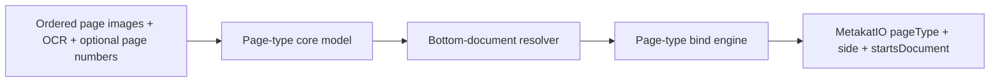

# Page-type processing

## Navigation

- [Purpose](#purpose)
- [Page-type core engine contract](#page-type-core-engine-contract)
  - [Input and result models](#input-and-result-models)
  - [Implementing another core engine](#implementing-another-core-engine)
- [Core and bind orchestration](#core-and-bind-orchestration)
  - [Pipeline configuration](#pipeline-configuration)
  - [Processing handoff](#processing-handoff)
- [Available core implementation](#available-core-implementation)
  - [ViT](#engine-vit-page_type_core_engine_vit)
  - [Context classification](#engine-context-classification-page_type_core_engine_context)
    - [Model files and architecture](#model-files-and-architecture)
    - [Feature extraction and normalization](#feature-extraction-and-normalization)
    - [Pagination signal](#pagination-signal)
    - [Scanning and merging](#scanning-and-merging)
    - [Standalone inference](#standalone-inference)
- [Bottom-document resolution](#bottom-document-resolution)
  - [Boundary policy configuration](#boundary-policy-configuration)
  - [Scoring and confidence](#scoring-and-confidence)
- [Available bind implementation](#available-bind-implementation)
  - [Base](#engine-base-page_type_bind_engine_base)
  - [Field mapping and precedence](#field-mapping-and-precedence)
- [Observability and revision](#observability-and-revision)

## Purpose

The `metakat.page_type` package classifies every page of an ordered scan batch
and establishes its bottom-level document boundaries: monographs or individual
issues within periodicals. It writes page types, optional sides, and resolved
start flags into `MetakatPage`.

Page-type processing has two boundaries:

1. The **[core engine](#page-type-core-engine-contract)** receives the complete
   ordered scan, predicts page labels and any additional model outputs, and
   resolves the bottom-level document partition across the scan.
2. The **[bind engine](#available-bind-implementation)** selects and orders
   MetaKat pages, resolves their input paths, invokes the core once, and writes
   the position-aligned results into a copy of `MetakatIO`.

The core owns classification, overlapping-window merging when needed, and
boundary resolution. The binder preserves these decisions. The following
[`biblio`](../biblio/README.md) stage consumes the established boundaries to
build the document hierarchy and associate bibliographic evidence with it.



## Page-type core engine contract

Every page-type core engine subclasses `PageTypeCoreEngine` and implements:

```python
predict(pages: list[PageTypeInput]) -> list[PageTypePrediction]
```

The shared base class exposes the pipeline entry point:

```python
process(pages: list[PageTypeInput]) -> list[PageTypePrediction]
```

`predict()` returns raw model decisions. `process()` validates those results,
requires exactly one result for each input, and then applies the shared
[bottom-document resolver](#bottom-document-resolution). Page types and sides
are preserved; `startsDocument` is replaced with the resolved decision at each
internal position. The first position returns `startsDocument=None`: it
implicitly begins the scan, with no claim about a preceding page.

Both methods retain input order. Position identifies a page, so repeated
image or OCR paths remain distinct scan positions. Neither the core nor the
binder splits the input into known documents before classification. The
available cores accept an empty list and return an empty list.

### Input and result models

```python
@dataclass(frozen=True)
class PageTypeInput:
    image_path: str | None
    ocr_path: str | None = None
    page_number: str | None = None


class PageTypePrediction(BaseModel):
    pageType: tuple[PageType, Confidence]
    side: tuple[PageSideType, Confidence] | None = None
    startsDocument: tuple[bool, Confidence] | None = None
```

| Input | Core contract |
|---|---|
| `image_path` | Resolved page-image path, or `None` for a missing image mapping. The ViT core requires an image for every page. |
| `ocr_path` | Optional resolved ALTO or PAGE XML path. The context core uses it for both text embeddings and layout statistics. |
| `page_number` | Optional page-number text, passed unchanged from `MetakatPage.pageNumber.text`. Only the context core consumes it. |

Missing paths represent unavailable modalities. Support depends on the selected
implementation: the context core requires at least an image or OCR input at
each position, while ViT requires an image. Unreadable or corrupt supplied files
are errors. Pages are never silently removed or reordered.

| Result | Core result contract |
|---|---|
| `pageType` | Required semantic `PageType` and confidence of the selected type. Enum values such as `titlePage` and `normalPage` are the schema vocabulary, independent of model label spellings. |
| `side` | Optional semantic `PageSideType` and confidence. The canonical schema values are `left`, `right`, and `singlePage`. |
| `startsDocument` | Optional boolean and confidence belonging to that boolean. `True` means **this** page begins a bottom-level document, including an issue rather than its containing periodical volume. After resolution, confidence describes a score margin, not a calibrated model probability. |

No detection UUIDs, bounding boxes, or parent relations are returned by this
core. Its result is one semantic prediction for every scan position. Independent
auxiliary page-start/page-end model heads do not add fields to this contract.

### Implementing another core engine

Every core receives its configuration mapping directly. To add one:

1. subclass `PageTypeCoreEngine` and call its constructor with the core mapping;
2. implement `predict()` with the complete ordered input and result contract,
   returning one result per page and leaving unsupported optional tasks unset;
3. retain the inherited `process()` handoff to the boundary resolver;
4. register the config `name` in `page_type_core_engines` in core `definitions.py`,
   including its runtime requirements;
5. test registration, model-label mapping, result alignment, missing inputs, and
   the binder handoff.

`PageTypeBindEngineBase` can bind any implementation satisfying this contract.
Its integration does not depend on the model architecture or feature encoders.

## Core and bind orchestration

### Pipeline configuration

The complete MetaKat pipeline configuration nests the page-type core and bind
mappings under `page_type`. A minimal ViT configuration is:

```json
{
  "page_type": {
    "core": {
      "name": "page_type_core_engine_vit",
      "model_dir": "page_type/core/model",
      "labels": {
        "titlePage": "TitlePage"
      }
    },
    "bind": {
      "name": "page_type_bind_engine_base"
    }
  }
}
```

Replace the `core` mapping with the
[context configuration](#engine-context-classification-page_type_core_engine_context)
to use contextual classification with the same binder.

The central pipeline loader resolves relative `*_path` and `*_dir` values
before construction. Core and bind loaders receive those prepared mappings,
read `name`, and resolve it through their registries. An unknown name is an
error; placing an implementation in the package does not register it.
Per-engine configuration files and directory-based loader arguments are not
part of the pipeline loader contract. The standalone commands accept an
explicit core configuration file.

### Processing handoff

When configured, `process_batch()` runs
[`page_number`](../page_number/README.md) before page-type processing, followed
by bibliographic and chapter processing. Page-type processing can therefore
consume existing physical page-number text without detecting it again.

The page-type binder owns the complete handoff:

1. copy `MetakatIO` and select all `MetakatPage` elements;
2. order them by ascending `batch_index`, the schema's scan order;
3. resolve image and OCR mappings relative to the batch directory;
4. pass all positions and existing page-number text to `core.process()` once;
5. validate result count and every prediction before attaching any outputs;
6. bind results back to those same page objects by position.

Duplicate page IDs or scan indices are errors. A missing mapping is passed as
`None` for the core to handle. OCR resolution prefers `page_to_alto_mapping`
and falls back to `page_to_xml_mapping` when the ALTO mapping is absent. It
does not retry a corrupt ALTO file as PAGE XML. Input image filenames do not
control scan order.

## Available core implementation

The registered core implementations are:

| Config `name` | Implementation |
|---|---|
| `page_type_core_engine_vit` | Existing per-image ViT classifier, followed by the shared boundary resolver with page-type evidence. |
| `page_type_core_engine_context` | DINOv2, mmBERT, grouped OCR statistics, and optional pagination supplied to contextual BERT; overlapping-window merging followed by the shared boundary resolver. |

### Engine: ViT (`page_type_core_engine_vit`)

The engine loads a local Hugging Face `ViTForImageClassification` and
`ViTImageProcessor` from `model_dir`. It processes each image independently,
selects the largest softmax probability, and maps that model label to a
semantic `PageType`. CUDA is selected when available, otherwise CPU.

#### Configuration

```json
{
  "name": "page_type_core_engine_vit",
  "model_dir": "page_type/core/model",
  "labels": {
    "titlePage": "TitlePage"
  }
}
```

`labels` maps semantic `PageType` values to model labels. Unspecified values
use the enum value itself. Unknown page types, empty/non-string labels, and
duplicate resulting labels are rejected. The checkpoint supplies its numeric
`id2label` mapping; it must have contiguous class IDs starting at zero, unique
model labels, and a semantic mapping for every class. A configuration-level
`id2label` is rejected; use `labels` instead.

`predict()` returns only page types; `side` and `startsDocument` are unset.
`process()` adds type-based boundary decisions through the shared resolver,
without a learned start score. Every page requires an image. This core handles
the complete input list internally even though its classifier is per-image.

The existing standalone command retains its full model-label probability
output for every image. It sorts the image directory by filename and calls
`predict_probs()`; it does not perform whole-scan boundary resolution:

```bash
python -m metakat.page_type.engines.core.page_type_core_engine_vit \
  --engine-config vit.json --image-dir /data/images --output-file scores.txt
```

### Engine: context classification (`page_type_core_engine_context`)

The engine completes the image pass, then OCR statistics, then the text pass; it adds available
pagination, and classifies overlapping windows of the ordered scan with BERT.
It predicts page type, side, and an adjacent-page boundary score. The inherited
`process()` then resolves bottom-level documents across the complete scan.

#### Configuration

The following is a **core mapping**, nested under `page_type.core` in the
pipeline configuration. All three model locations are required; the context
artifact does not contain the image or text encoder weights.

```json
{
  "name": "page_type_core_engine_context",
  "device": "cuda",
  "image_checkpoint_path": "page_type/core/dino/exported_last.pt",
  "image": {
    "batch_size": 32,
    "expected_sha256": "d08f6d05da58efff5748274f487c2583d94cad5ee9e0490a57e40c3a3832f80e"
  },
  "text_model_dir": "page_type/core/mmbert",
  "text": {
    "batch_size": 8,
    "max_tokens_per_batch": 16384,
    "max_length": 8192,
    "max_chars": 4000
  },
  "checkpoint_path": "page_type/core/context.pt",
  "inference": {
    "window_size": 512,
    "tail": "regular",
    "batch_size": 8,
    "start_threshold": 0.5,
    "overlap": 64,
    "overlap_merge": {
      "method": "center_logits",
      "ramp_end_fraction_of_overlap": 0.75,
      "ignored_edge_fraction_of_overlap": 0.1875,
      "ramp_power": 3
    }
  }
}
```

`device` defaults to CUDA when available, otherwise CPU. The example explicitly
selects CUDA. `image.expected_sha256` is optional and verifies the image
checkpoint before loading it. Text batch size and token budget are independent
of the contextual model's window batch size. There is no shared outer chunk size.
DINO batches images directly; mmBERT consumes OCR text lazily in bounded batches.
The separate statistics and text passes read each OCR file twice so all page
texts do not need to remain in RAM. Model weights remain loaded across passes.

An optional `inference` mapping overrides settings exported with the checkpoint.
`window_size` counts pages per window and `overlap` counts pages shared by
consecutive windows. The engine derives the advance as `window_size - overlap`;
`overlap_merge` groups all settings controlling the combination of overlapping
predictions. Only the current grouped configuration is accepted:

```json
{
  "inference": {
    "window_size": 512,
    "tail": "regular",
    "batch_size": 8,
    "start_threshold": 0.5,
    "overlap": 64,
    "overlap_merge": {
      "method": "center_logits",
      "ramp_end_fraction_of_overlap": 0.75,
      "ignored_edge_fraction_of_overlap": 0.1875,
      "ramp_power": 3
    }
  }
}
```

These are the selected deployment defaults: 512-page windows, overlap 64,
cubic weighting, a ramp covering 3/4 of the overlap, and an ignored edge
covering 3/16 of the overlap. The active ramp follows that ignored edge. For overlap 64 the resolved ramp is 48 pages and
the ignored region is 12 pages. The formulas are:

```text
ramp_end = max(1, floor(overlap * overlap_merge.ramp_end_fraction_of_overlap))
ignore   = floor(overlap * overlap_merge.ignored_edge_fraction_of_overlap)
weight   = clip((distance - ignore) / (ramp_end - ignore), 0, 1) ** overlap_merge.ramp_power
```

There is no additive weight floor. Changing overlap automatically rescales
the ramp and ignore counts. The ignored-edge fraction must be in `[0,0.5]`; the
resulting ignored pages may not exceed half the overlap. `ramp_power` must be a
positive integer. Power 1 is linear; power 3 is the selected cubic policy.
The ramp fraction must be positive and finite.

The `overlap_merge` override is merged by field with artifact settings, so
changing only `ramp_power` retains its other settings. Artifacts must store this grouped policy. Unsupported artifacts must be
re-exported; obsolete settings are rejected. Only the regular short-tail
strategy is supported. The engine logs the effective
policy and resolved page counts at startup.

The window cannot exceed the checkpoint's learned position limit. The shared
`boundary_policy` mapping is documented under
[boundary policy configuration](#boundary-policy-configuration).

#### Model files and architecture

The context engine deploys only the current model and inference contract.
Obsolete configurations are removed rather than maintained through migration
paths; re-export the selected checkpoint when the contract changes.

Export a **trusted local** checkpoint from `classification-with-context`:

```bash
python -m page_sequence.export --checkpoint /path/to/best.pt --output /models/context.pt
```

The exporter reads the training pickle once and writes tensors plus primitive
metadata. MetaKat loads this deployment artifact with `weights_only=True`.
It contains architecture, class order, feature normalization/schema, pagination
policy and cap, and deployment inference settings (512/448, regular tail,
centre-weighted logits, cubic power 3, ramp endpoint at 3/4 of overlap, ignored edge of 3/16 overlap). These replace the historical
training-validation overlap rather than copying it into deployment. Optimizer state, RNG, and training
source paths are omitted. Export the selected `best.pt`, rather than assuming
the last update is best. No trained checkpoint is bundled with the code.

The only accepted format is `metakat_context_v4`, with:

- a BERT backbone and separate image, text, statistics, pagination, and boundary MLPs;
- five boundary bits per page: scan start, scan end, document metadata provided,
  document start, document end;
- per-page type and side heads;
- the learned adjacent-pair boundary head;
- independent linear page-start and page-end heads.

Loading validates the architecture, label order, all five heads with strict
weight loading, pagination policy, feature schema, and encoder dimensions.
Legacy v1/v2/v3 artifacts, missing head weights, and other architectures fail;
artifact/schema checks precede loading the feature encoders.

Use the same encoders as the training dump:

| Encoder | Required training identity |
|---|---|
| DINOv2 with registers, ViT-B/14 | Original LightlyTrain exported state dictionary; SHA256 `d08f6d05da58efff5748274f487c2583d94cad5ee9e0490a57e40c3a3832f80e`. |
| mmBERT-base | Local model and tokenizer for `jhu-clsp/mmBERT-base`, revision `c5955035435e2bf121cde7f3c8863ef52ff35d82`. |

The mmBERT loader uses local files only. A generic DINO checkpoint is not a
substitute for the original image encoder. The inference implementation freezes
the training feature contract locally, with no runtime dependency on the
training repository, SQLite, LMDB, or database dumps.

#### Feature extraction and normalization

The context implementation lives in `engines/core/context/`:

| Module | Responsibility |
|---|---|
| `dino.py` | Image embeddings: final normalized CLS token after a 224 × 224 whole-image resize with OpenCV INTER_AREA and ImageNet scaling. |
| `mmbert.py` | OCR text embeddings: attention-masked mean pooling, head truncation preserving the final special token, and the training dump's padding-NaN fix. |
| `alto_stats.py` | ALTO/PAGE XML text and layout extraction, all 3,324 raw statistics, and all 147 grouped normalized features. |
| `pagination.py` | The same candidate filtering and five-feature pagination encoding used in training. |
| `context.py` | Feature extraction orchestration, contextual model invocation, whole-scan merging, semantic outputs, and the standalone command. |
| `dinov2_checkpoint.py` | Strict conversion and loading of the LightlyTrain image checkpoint into the inference backbone. |
| `models.py`, `merging.py`, `labels.py`, `_page_stats.py`, `_ocr_xml.py` | Local architecture, scanning, class order, and feature-contract implementations. |

OCR lines are reconstructed in top-to-bottom order and joined with newlines.
`text.max_chars: 4000` mirrors the pilot's database text cap; text is capped
before embedding. Statistics always use the whole OCR page. A different text
export must be checked for equivalent reconstruction and capping even when
its OCR content is otherwise the same.

Dense vectors and raw statistics round through FP16 as in the training stores.
Dense vectors are then L2 normalized; statistics use the saved bounded
normalizer and are divided by `sqrt(147)`. The separate projections combine
these inputs with availability flags. Missing branches are masked after their
MLPs so biases do not create a false signal.

CPU encoders compute in FP32. CUDA uses FP16 DINO and BF16 mmBERT computation,
matching the dump. The context model uses FP16 autocast on CUDA with FP32 parameters;
CPU inference uses FP32. CPU/GPU feature extraction
can produce small numerical differences.

Feature extraction retains compact per-page vectors and merged outputs
proportional to page count, rather than all decoded images or OCR texts at
once. Image, text-token, and window batches are bounded
separately. A missing OCR mapping masks both text and statistics; a genuinely
blank OCR page remains present. A missing image mapping masks image features.
A page missing both image and OCR retains its scan position with zero modality
features and availability flags. Pagination and boundary inputs remain available.

#### Pagination signal

The binder passes `MetakatPage.pageNumber.text` unchanged as
`PageTypeInput.page_number`. Run the page-number stage first to supply it.
Page-type inference does not fill, alter, or infer page numbers.

Filtering follows `db_candidate_single_v1`:

| Page-number text | Signal |
|---|---|
| Positive Arabic integer or canonical Roman numeral | Accepted candidate. |
| `55 [58]` | Use the unbracketed `55`. |
| `[12]`, `[XIV]` | Missing: bracket-only inferred numbers are excluded. |
| Zero, suffixes, ranges, multiple numbers, or malformed values | Missing. |

Unbracketed metadata remains a noisy candidate, not proof of physical printing.
The five inputs are capped log magnitude, odd parity, Arabic flag, Roman flag,
and availability. The cap comes from the artifact, normally 10000. Features
round through FP16 as in training. Rejected or missing numbers become five
zeros and their projected branch is masked after the MLP. Entire scans without
page numbers remain supported. No page-number confidence, scan index, known
document length, or neighboring-number difference is supplied as a feature.
There is no inference-time dropout.

#### Scanning and merging

BERT attends bidirectionally within each window. Learned absolute position
embeddings reset for every window. Window size, overlap, edge ramp, merge rule,
boundary threshold, and batch size come from the exported artifact unless
explicitly overridden. Scans shorter than the window, including a single page,
are supported. Longer scans are processed in overlapping windows. The default
window is 512 pages with overlap 64; the internal advance is therefore 448 pages. Window starts advance regularly;
the last window stays at its scheduled start and accepts a shorter input. For
1,024 pages the spans are `[0,512)`, `[448,960)`, `[896,1024)`: the last input
has 128 pages. There is no backward shift to make the last window full.
CUDA uses FP16 autocast with FP32 model parameters and FP32 merge accumulators;
CPU uses FP32.

The default experiment strategy accumulates centre-weighted logits over
overlaps and applies softmax or sigmoid afterward. Weights are
`clip((distance - ignore) / (ramp - ignore), 0, 1) ** ramp_power` with no
additive floor, where all three controls come from `overlap_merge`. The ignored edge is before
the active ramp; no portion of the active ramp is discarded. The first
included page is at distance 1. True scan endpoints are exempt from the
corresponding edge penalty. Full weight is reached at the ramp endpoint. Available merge values are
`center_logits`, `uniform_logits`, `center_probs`, `uniform_probs`, and `central`
(the most central window, with an earlier-window tie break). Page and adjacent
pair coverage are tracked separately.

The boundary head compares adjacent contextual page representations. Each
window's first boundary output is excluded because its predecessor is outside
that window; overlap supplies that pair elsewhere. Only the entire scan's
first page has no valid predecessor and returns `startsDocument=None`.
For other positions, raw `predict()` returns a boolean and confidence of that
boolean from the merged pair probability.

The independent page-start/page-end heads are loaded and computed from each
page representation. Their influence on the boundary head is through the shared
encoder learned during training. Their probabilities are neither inputs to the
pair head nor manually combined with its score at inference. Consistency
regularization is a training loss; it adds no inference parameters or decoding
rule. Scan start/end bits are set only at the true endpoints, then sliced with
each window. By default the document metadata bits are unknown. The standalone
page list / `PageTypeInput` may supply `document_start` and `document_end` for
every page (including explicit false values); a partial set is rejected. These
are model inputs, not output overrides. A single known document can therefore
supply true only at its first/last page. Ordinary pipeline input supplies scan
endpoints and available page numbers; existing page-type labels are not inputs.
Fully missing image/OCR pages retain their position with zero features and
modality-presence bits, as in training.
The separate [resolver](#bottom-document-resolution) then uses predicted types
and pair-boundary scores to choose the final partition.

#### Standalone inference

Create an ordered JSON list of page inputs:

```json
[
  {"image_path": "scan1.jpg", "ocr_path": "scan1.xml", "page_number": "12"},
  {"image_path": "scan2.jpg", "ocr_path": null, "page_number": "[13]"}
]
```

```bash
python -m metakat.page_type.engines.core.context.context \
  --engine-config context.json --pages pages.json --output predictions.json
```

`context.json` contains the core mapping, not the complete pipeline mapping.
Model paths resolve relative to that file; page paths resolve relative to
`pages.json`. Output is a position-aligned JSON list of semantic `pageType`,
`side`, and `startsDocument` tuples serialized as arrays. This command calls
`process()`, including boundary resolution. `predict()` exposes raw model
outputs; `scan_features()` exposes raw merged probabilities for evaluation.

## Bottom-document resolution

Both registered engines run the standalone policy in
`engines/core/boundaries.py` after raw prediction. It finds the best partition
of the whole scan into bottom-level documents, preserving predicted page
types and sides. It works with learned start probabilities when present and
falls back to page-type evidence when they are absent.

### Boundary policy configuration

Either core accepts the following `boundary_policy` mapping. Values shown are
the defaults; all must be finite and nonnegative.

```json
{
  "boundary_policy": {
    "model_weight": 1.0,
    "split_penalty": 1.5,
    "misplaced_type_penalty": 8.0,
    "content_in_margins_penalty": 0.25,
    "opening_run_cut_penalty": 5.0,
    "before_closing_cut_penalty": 6.0
  }
}
```

| Setting | Effect |
|---|---|
| `model_weight` | Weight of the current page's model start log odds in the score for a cut before that page. Missing model evidence contributes zero. |
| `split_penalty` | Cost of introducing a new bottom-level document. |
| `misplaced_type_penalty` | Cost of assigning an opening type outside the opening phase or a closing type outside the closing phase. |
| `content_in_margins_penalty` | Cost of assigning other content types to an opening or closing phase. |
| `opening_run_cut_penalty` | Cost of cutting after opening matter, including across intervening neutral pages. |
| `before_closing_cut_penalty` | Cost of cutting immediately before closing matter. |

### Scoring and confidence

A three-phase dynamic program models opening pages, content, and closing
pages. Continuations can advance phases but cannot move backward. A cut can
start a new document in any phase, allowing incomplete scans. The type sets are:

| Role | Semantic page types |
|---|---|
| Opening | `frontCover`, `frontEndPaper`, `frontEndSheet`, `frontJacket`, `frontispiece`, `titlePage`. |
| Closing | `backCover`, `backEndPaper`, `backEndSheet`. |
| Neutral | `blank`, `cover`, `jacket`, `spine`, `edge`, `flyleaf`, `calibrationTable`. |
| Content | All remaining page types. |

Type costs are scaled by `max(0, 2 * confidence - 1)`. Neutral types carry no
phase cost and do not terminate an opening run. Low-confidence types therefore
supply little or no structural evidence. A supplied false start decision is
converted back to its true-start probability before taking log odds.

All penalties are finite. A model score can outweigh a page-type preference,
and a clear opening/closing pattern can outweigh a model score. Title-less
documents can be separated by the model; repeated title pages alone do not
force separate documents. There is no minimum document length or boundary
non-maximum suppression.

The resolver uses linear time and memory in the number of pages, including a
backward pass to compute the best complete solutions with and without each
boundary. The confidence of its selected boolean is the sigmoid of that score
margin. It describes the resolver's preference, not calibrated probability or
measured accuracy. Continuation wins exact score ties. Position zero remains
implicit and returns `startsDocument=None`.

These initial weights require development-set tuning. Raw model evaluation
and resolved pipeline behavior are distinct: use `predict()` or
`scan_features()` when assessing the model before this policy is applied.

## Available bind implementation

The registered bind implementation is:

| Config `name` | Implementation |
|---|---|
| `page_type_bind_engine_base` | Ordered whole-scan handoff and position-aligned schema binding. |

### Engine: Base (`page_type_bind_engine_base`)

#### Configuration

```json
{
  "name": "page_type_bind_engine_base"
}
```

The base binder follows the [processing handoff](#processing-handoff) for all
MetaKat pages, including pages with missing mappings. It does not preselect
only title pages, split documents, or reorder pages by filename. `proarc_io`
is accepted by the shared bind interface but is not used by this implementation.
An input without page elements returns a copied `MetakatIO` without invoking
the core. The core is also skipped when every page type has `annotated: true`,
even if side or document-start values are absent. In a mixed batch every page
still reaches the core, including annotated pages, to preserve context.

### Field mapping and precedence

| Core result | MetaKat binding |
|---|---|
| `pageType` | Replaces `MetakatPage.pageType` unless its existing value has `annotated: true`. |
| `side` | Replaces `MetakatPage.side` when supplied; otherwise preserves the existing value. |
| `startsDocument` | Replaces `MetakatPage.startsDocument` when supplied; otherwise preserves the existing value, including at the scan's first position. |

Unlike page-number confidence precedence, this binder does not compare new
and existing confidences. Only an explicitly present boolean annotation flag
protects an existing page type; absent, null and false allow replacement. The flag
is not yet enforced for side or document-start outputs. Bound classifier fields
use typed value objects with `text`, `confidence`, `lang`, `id` and optional
`annotated`. Older input pairs are accepted and normalize to objects; the internal
core prediction contract remains compact value/confidence pairs.
Optional absent tasks remain compatible with the ViT model and other cores
that do not predict sides. All outputs are validated before any field is bound.

`startsDocument` survives internal JSON serialization. Bibliographic grouping
consumes it to establish bottom-level containers and higher hierarchy. MODS
records the resulting hierarchy rather than exporting this internal flag
directly. The binder does not create detection geometry or parent links. Classifier value
objects receive identities without creating OCR detection mappings.

## Observability and revision

Core and bind loading and the number of input pages are logged at `INFO`.
The ViT core reports progress every 100 images. Boundary resolution logs the
number and scan positions of decisions it changed relative to supplied model
start decisions. Type-only resolution has no model decisions to compare.

Unrecognized engines, invalid label mappings, duplicate scan indices/IDs,
result-count mismatches, invalid predictions, missing required inputs, and
incompatible context artifacts fail explicitly. Unreadable feature inputs
also fail rather than becoming silent missing data.

For model diagnosis, inspect raw `predict()` results or merged
`scan_features()` probabilities before the shared resolver. For policy diagnosis,
compare those decisions with `process()` and its resolver-change log, and tune
weights on development data. Start/end auxiliary heads and consistency losses
belong to training; final boundary policy choices are documented here alongside
the engine that applies them.
